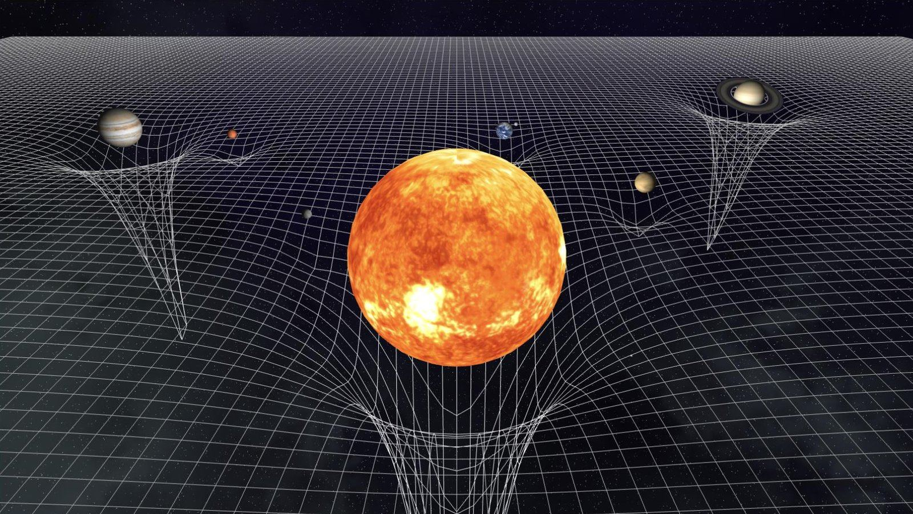

# SpaceTime 3D

A 3D solar system in C++ and OpenGL where a wireframe spacetime grid sinks beneath each planet based on its mass, visualizing how gravity bends space. Inspired by the classic rubber-sheet gravity demo and Kerbal Space Program.



Final project for JHU EN.605.667 Computer Graphics (Fall 2025). More details on my [portfolio](https://bryancgarry.github.io/projects/spacetime-3d.html).

## Features

- **Spacetime grid:** an extruded surface of interconnected vertices drawn with `GL_LINES`. Each vertex is displaced using every body's mass with `g = G·M / r²`, and the vertex buffer is updated every frame.
- **Orbits:** planets move along curved paths using polar coordinates, handled by a custom transform node.
- **Multi-texturing:** Earth blends day and night textures based on the sun's direction and each fragment's normal, with a cloud layer on top.
- **Skybox:** a cubemap cube centered on the camera, drawn at the far plane (`gl_Position = pos.xyww`) so it always sits behind the scene.
- **Saturn's rings:** a dedicated geometry node with an alpha-mapped ring texture.
- **Camera:** free navigation, focusing on individual planets, and pausing the simulation.

## My Code

Built on the course's scene graph framework. The files I wrote or changed:

| Area | Files |
|---|---|
| Scene setup and camera controls | `Module10/main.cpp` |
| Planet orbits | `Module10/celestial_body_transform_node.hpp/.cpp` |
| Spacetime grid | `Module10/space_time_grid.hpp/.cpp` |
| Multi-texturing | `Module10/lighting_shader_node.hpp/.cpp`, `Module10/pixel_lighting_tex.frag`, `scene/scene_state.hpp`, `scene/presentation_node.hpp/.cpp` |
| Skybox | `Module10/skybox.hpp/.cpp`, `Module10/skybox_shader_node.hpp/.cpp`, `Module10/skybox_shader.vert/.frag` |
| Saturn's rings | `Module10/saturn_ring.hpp/.cpp` |
| Camera changes | `scene/camera_node.hpp/.cpp` |

The full write-up I submitted is in [`FinalProject_README.txt`](FinalProject_README.txt).

## Building

The project uses the course framework's CMake build. Third-party libraries are **not** included in this repo: SDL3, Assimp, zlib, stb, and GLEW on Windows.

1. Put the prebuilt libraries in `lib/<platform>/` (for example `lib/macos/SDL3.framework`, `lib/macos/assimp`) and their headers in `include/` (`include/SDL3`, `include/assimp`, `include/stb`).
2. Generate and build:
   ```bash
   mkdir build && cd build
   cmake .. -G Xcode
   ```
3. Open the generated project and run the **Module10** target.

Planet textures are downsized to 4K for this repo.

Developed and tested on macOS with Xcode.
